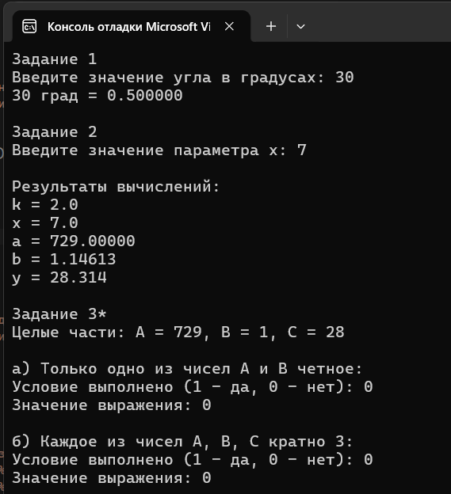

# Лабораторная работа 5

## Цель работы
Получение практических навыков построения линейных программ с использованием оператора присваивания,  арифметических операций и математических функций стандартной библиотеки языка Си.

## Результаты работы программы

## Информация о разработчике
Орлова Эльвира Эдуардовна
Группа: бИД-261
